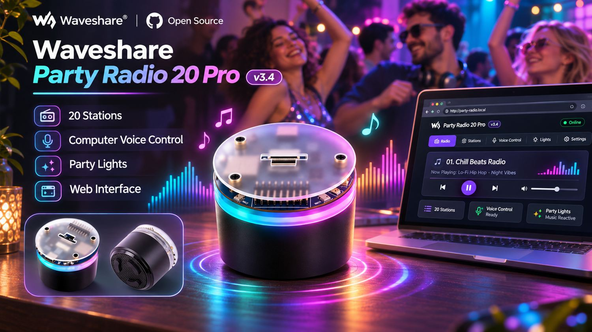
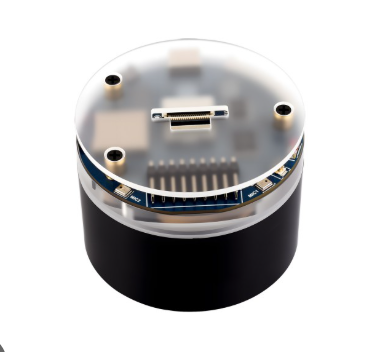
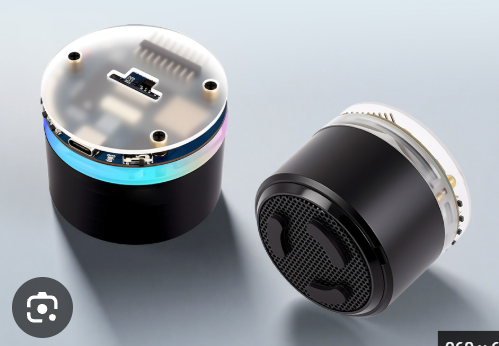
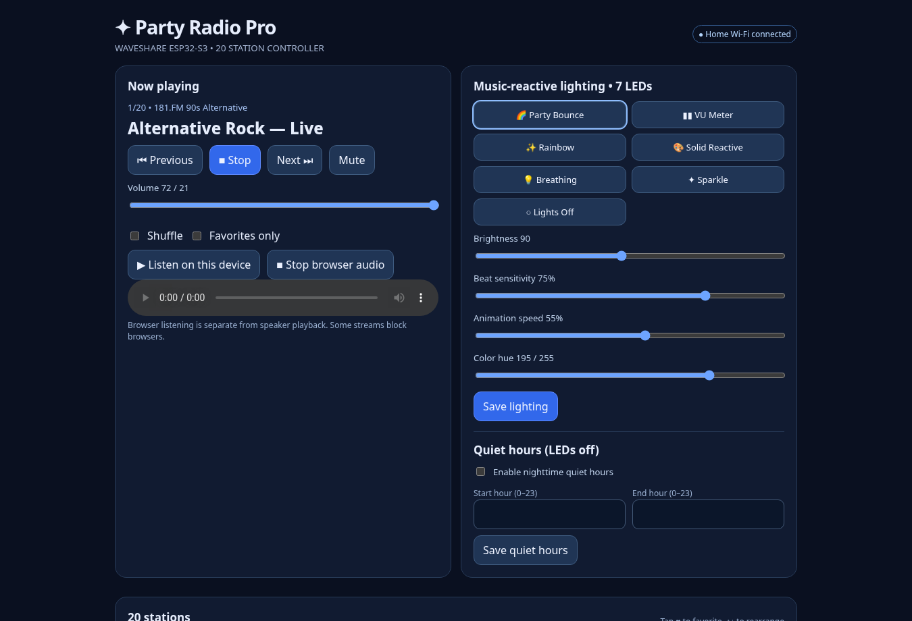
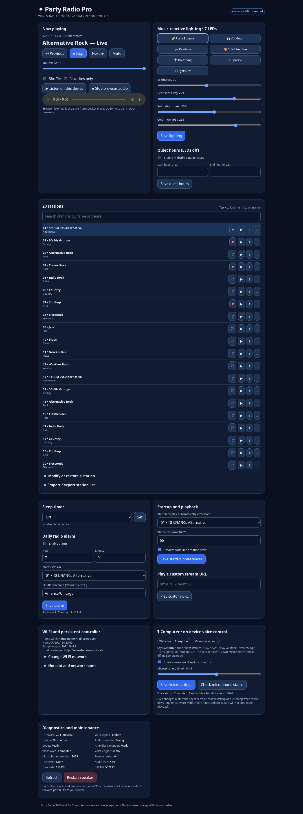
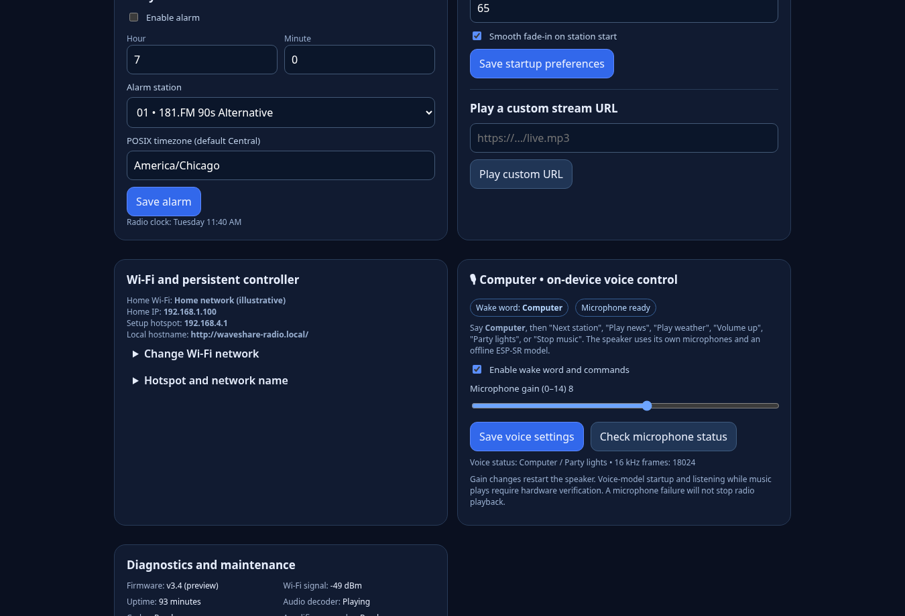
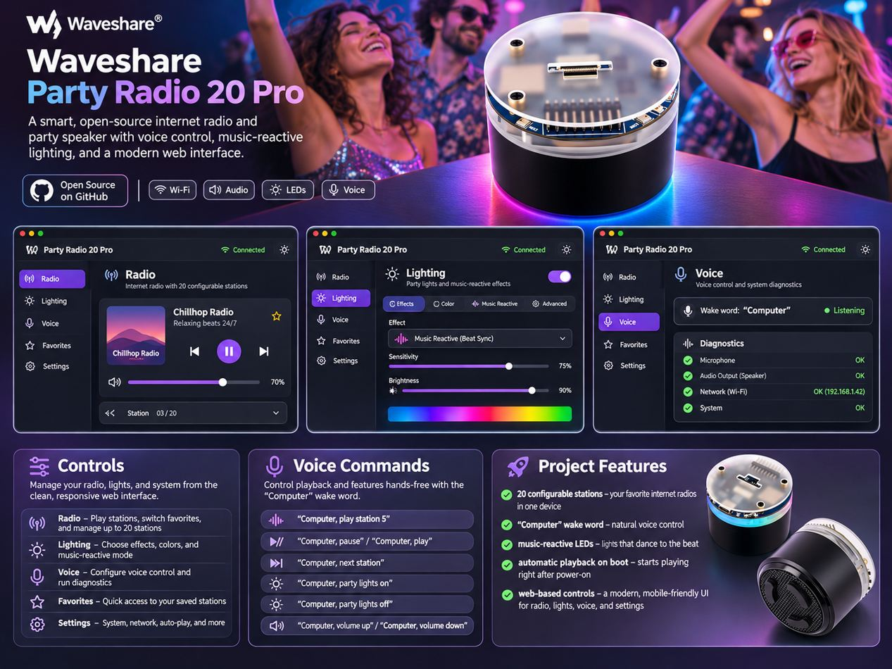

<div align="center">

# 🎛️ Waveshare Party Radio 20 Pro

### Internet radio · RGB party lights · offline “Computer” voice control · responsive web dashboard



**20 customizable stations** · **7 music-reactive RGB LEDs** · **Offline wake word** · **Windows one-click build & flash**

[Getting started](#getting-started) · [Web dashboard](#web-dashboard) · [Voice commands](docs/VOICE-COMMANDS.md) · [Troubleshooting](docs/TROUBLESHOOTING.md)

</div>

> [!IMPORTANT]
> **Experimental source release, v3.4 (November 2026).** The project includes firmware source and a build-and-flash installer, **not a verified precompiled BIN**. Earlier builds had Windows toolchain/compiler failures, and v3.4's GCC workaround has not yet been confirmed on the physical Waveshare board. The wake word, audio streaming, and microphone coexistence still need board testing. The installer must successfully compile and validate voice-model files before flashing. **No firmware backups are performed.**

## Gallery

### The actual Waveshare hardware design

Images provided by the project owner showing the cylindrical speaker, translucent top, and RGB ring; not photographs of a running v3.4 unit.

| Hardware top | Hardware angles |
| :---: | :---: |
|  |  |

### Party Radio web dashboard — rendered from the project HTML

The following are **actual browser screenshots of the `src/web_ui.h` controller**, rendered locally with *mock station/status responses*. They demonstrate the UI layout; displayed statuses are illustrative, not measured from a real flashed board.



<details><summary>Full interface screenshot</summary>



</details>



### Party Radio at a party (illustrative artwork)



*Artist-generated promotional render, not documentary photography or a physical product demonstration.*

## Key features

| Radio | Lighting | Voice | Connectivity & management |
|---|---|---|---|
| 20 editable station presets | 7 RGB LED effects | Wake word **Computer** | Persistent Wi-Fi setup hotspot |
| Autoplay on boot | Music-reactive party mode | Offline station commands | Local hostname `waveshare-radio.local` |
| Favorites / favorites-only | Rainbow / VU meter / sparkle | Volume / playback commands | Station JSON import/export |
| Shuffle & custom streams | Beat sensitivity, hue, speed | Lighting / sleep commands | Diagnostics, restart, Wi-Fi scan |
| Startup volume & fade | Quiet hours | Microphone gain / error status | Alarm & sleep timer |

## Getting started

1. Download the repository as a ZIP or clone it.
2. Connect the **Waveshare ESP32-S3-AUDIO-Board** using a USB data cable.
3. On Windows, double-click **`FLASH-WAVESHARE.bat`** from the extracted project directory. Initial build needs Python 3.13, Git, PlatformIO downloads, and internet access.
4. Choose the ESP32-S3 COM port and enter **`FLASH`** only after a successful build and model check. This **overwrites** the current Waveshare firmware, without a flash backup.
5. Join Wi-Fi hotspot `PartyRadio-Setup` using default password `party-radio20`, visit **http://192.168.4.1**, and enter your home network credentials. **Change the default hotspot password** in Settings afterward.
6. On your home LAN, open **http://waveshare-radio.local** (where mDNS is supported) or use the speaker's local IP. The device can keep its setup hotspot available.

**Important:** Internet radio presets require working streaming URLs; NOAA internet relays are not a substitute for an emergency weather radio. Avoid port-forwarding the unencrypted local control page.

## Source tree

```text
src/main.cpp               Internet radio, LED effects, API, scheduler
src/voice_engine.cpp       ESP-SR audio / Computer wake word and commands
src/web_ui.h               Full embedded browser dashboard
src/default_stations.h     Preset table
scripts/flash.ps1          Windows build / model check / direct flash
scripts/prepare-libs.ps1   Fetch audio codec/decoder dependencies
platformio.ini             PlatformIO build configuration
sdkconfig.defaults         Arduino + ESP-IDF compiler settings
partitions.csv             Voice-model partition layout
stations.csv               20 starter station URLs
assets/                    Hardware renders, dashboard screenshots, art
```

## Build status

The last full v3.3 build log failed with an **internal GCC segmentation fault in ESP-IDF's LCD driver**. v3.4 changes compiler optimization to `-Os` and sets single-worker compilation to mitigate that crash; **a successful v3.4 build has not been demonstrated**. Flash/voice hardware testing remains outstanding. See [troubleshooting](docs/TROUBLESHOOTING.md) for known errors.

---

# Detailed technical documentation

# WAVESHARE PARTY RADIO 20 PRO — v3.4 COMPUTER VOICE + GCC LCD BUILD FIX

Target: **Waveshare ESP32-S3-AUDIO-Board**, with ES8311 speaker, ES7210 dual microphone controller, TCA9555 buttons, and 7 WS2812 LEDs. **Not** for the Heltec or LILYGO T-Embed.

## Installation (Windows)

1. Extract the entire ZIP to a writable folder on Windows (not inside another ZIP).
2. Plug in the Waveshare board with a USB **data** cable.
3. Double-click **FLASH-WAVESHARE.bat** (PowerShell, Git, Python 3.13 recommended, and internet connection for first build).
4. The script pins **PlatformIO 6.1.19** and uses an **isolated** cache at `%LOCALAPPDATA%\PartyRadio20Pro\pio`, avoiding the known SCons version conflict and leaving your other ESP32 project installations alone. It then fetches decoder / speech models, compiles, and checks for `srmodels.bin` **before flashing anything**.
5. Select the Waveshare COM port and enter `FLASH` to flash the firmware. **No firmware backups. No flash-read operation.**
6. The script flashes the **ESP-SR model** to the `model` partition at 0x620000. Flashing only the application is insufficient for voice commands.
7. Join `PartyRadio-Setup` (password `party-radio20`) and visit `http://192.168.4.1/` to enter home Wi-Fi details. After it connects, use the same hotspot or `http://waveshare-radio.local/` on the local network. The hotspot stays enabled by default.

## Radio + 20 additions retained

- 20 editable presets: #1 **181.FM 90s Alternative** (plays on boot); rock/grunge, indie, country, electronic, jazz, world/news/talk, and 2 NOAA weather streaming relays.
- Favorite presets, favorites-only, shuffle, station reorder, edit/restore, import/export **station list** (not a flash backup), custom stream.
- Sleep timer, alarm with timezone, startup station, startup volume, smooth volume fade-in, mute.
- Seven modes for seven RGB LEDs: party audio-bounce, VU meter, rainbow, solid reactive, breathe, sparkle, off; sensitivity, speed, hue, brightness and nighttime quiet hours.
- Wi-Fi persistent AP + LAN mDNS web controller, network scan, diagnostics, controls, restart.
- 3 hardware keys: previous, play/pause, next; hold previous/next for volume.

## New: "Computer" voice

Powered by Espressif **ESP-SR WakeNet9** (`wn9_computer_tts`) + **English MultiNet6**, on the ESP32-S3 itself. No Pi, PC or cloud required by the voice engine.

**Say COMPUTER and then one of:**

- "Next station", "Previous station", "Play music", "Stop music", "Volume up", "Volume down", "Mute".
- "Play alternative rock", "Play grunge", "Play rock", "Play country", "Play electronic", "Play news", "Play weather radio", "Play station one".
- "Party lights", "Rainbow lights", "Lights off", "Brighter lights", "Dim the lights", "Favorites only", "Shuffle stations", "Sleep in thirty minutes", "Sleep in one hour".

Mono WakeNet event now transitions into MultiNet command-recognition mode. The web UI shows voice engine startup status, microphone frame counter, last command, enable/disable toggle and mic gain. The 48 kHz microphone audio is downsampled to 16 kHz for ESP-SR; when "Computer" is detected, the radio volume ducks and LEDs turn blue temporarily.

## Technical limitations / important cautions

**This ZIP contains actual new source plus an installer, not a verified precompiled .bin.** An ESP32-S3 firmware compiler and physical Waveshare device are not available in this environment. This hybrid Arduino/ESP-IDF + ESP-SR build has **not** been compiled here or verified on your hardware. The original v2 radio code is retained, but firmware builds may need fixes for upstream versions, and real simultaneous audio output + microphone input needs hardware tuning. The installer **aborts BEFORE flashing** if firmware compilation fails or the ESP-SR model binary is absent.

The onboard ES7210 is configured for two mics on shared I2S clocks; the receiver uses I2S1 in slave mode and 48→16kHz downsampling. This requires verification on actual hardware, particularly with loud music (acoustic echo can cause false triggers). If the mic engine fails after flash, the web status panel gives a reason; internet radio should remain operational.

**The new flash layout reserves 6MB for voice models**. It changes the LittleFS offset, so previously saved custom stations may need to be re-imported. You can export a 20-station JSON from the existing radio web panel if you want your edits. This is only station-list export, **not a Waveshare firmware backup**.

Internet stations may discontinue or change their URLs; NOAA presets are volunteer internet relays and do not replace a real emergency weather radio.

## Sources / code dependencies

- Board: https://docs.waveshare.com/ESP32-S3-AUDIO-Board
- On-device voice models: https://github.com/espressif/esp-sr
- Arduino ESP-SR integration: https://github.com/espressif/arduino-esp32/tree/master/libraries/ESP_SR
- ES7210 initialization reference: https://github.com/espressif/esp-adf/blob/release/v2.x/components/audio_hal/driver/es7210/es7210.c
- Radio decoder: https://github.com/schreibfaul1/ESP32-audioI2S

No firmware binaries, audio streams, or proprietary models are bundled; installer fetches compatible versions on the user's computer. Firmware does not modify Windows Sammy, Raspberry Pi RadioVault or the T-Embed.

## v3.1 repair notes (November 10, 2026)

Your log showed `ModuleNotFoundError: No module named 'SCons.Tool.FortranCommon'` after Core 6.2.0 installed `tool-scons 4.11.1`, but the pinned PIOArduino platform 55.03.39 tried to install `tool-scons 4.8.1` mid-build. v3.1 pins **PlatformIO Core 6.1.19** and isolates its tools under your user AppData (`PartyRadio20Pro\pio`). This is the documented workaround; this package has **not** been compiled on your Windows hardware. The existing `%USERPROFILE%\.platformio` remains untouched.

A second source fix handles the **mono WakeNet `SR_EVENT_WAKEWORD`** event by immediately changing to `SR_MODE_COMMAND`. The previous v3 code transitioned only on the stereo-specific channel verification event.

**No firmware backup, flash-read, or backup prompt** has been added. Flash is offered only after the build and speech model checks succeed, and only when you type `FLASH`.

If the first build still fails, **copy the last 50 lines of the new output**. Do not delete your user-wide `.platformio` folder.

## v3.2 linker repair (November 10, 2026)

The user's v3.1 log reached firmware linking and failed at undefined `app_main` and SSL symbols (`ssl_init`, `stop_ssl_socket`, and others). These match a hybrid Arduino/ESP-IDF default-configuration issue: `CONFIG_AUTOSTART_ARDUINO=y` is required for Arduino `setup()`/`loop()`, and `CONFIG_MBEDTLS_PSK_MODES=y` + `CONFIG_MBEDTLS_KEY_EXCHANGE_PSK=y` enable the functions compiled by the Arduino secure client. These are enabled in this release's `sdkconfig.defaults`. The old unsupported `board_build.sdkconfig` key was removed; PlatformIO reads the root defaults automatically. An additional preflight checks settings and voice model before the flasher offers to change the device.

**NOT VERIFIED:** This updated source cannot be compiled locally because the Windows ESP32-S3 toolchain is not available in this environment. The original build completed C++ compilation but not linking. The additional linker fixes are grounded in Espressif/PlatformIO documentation, not a proven binary. The ES7210 mic and the ESP-SR wake word still require actual board testing. An incorrect/missing model image stops flashing before device changes.

For the **fastest repair**, use the separate `PartyRadio-v3.1-LINK-HOTFIX.zip` to patch the existing v3.1 directory and reuse its downloaded libraries and compilation cache rather than repeating all downloads.

References: https://community.platformio.org/t/arduino-as-espif-component-in-platformio-solution-that-works/36542 and https://github.com/espressif/arduino-esp32/issues/11170

## v3.3 fixes (November 10, 2026)

Your **v3.2 build completed successfully** but the installer rejected a generated SDKCONFIG setting. The previous installer matched `CONFIG_...=y` using an end-of-line regular expression on raw text. Windows CRLF lines can make that test falsely fail. v3.3 verifies actual generated configuration line-by-line after trimming whitespace, without turning off safety checks.

After a clean compiled build, the installer also validates that the **real** ESP-SR Computer (`wn9_computer_tts`) and English MultiNet6 (`mn6_en`) data folders and `srmodels.bin` are present. It attempts Espressif's official model packer if a hybrid PlatformIO build did not create those images automatically. It refuses to flash if models are missing, or exceed the 6 MB partition.

This is a packaging/source repair, **not a precompiled firmware binary**. Audio, dual-mic operation, and voice detection have not been hardware-tested. No firmware backup is made or asked for.


## v3.4 Windows GCC LCD compiler crash repair (November 10, 2026)

The v3.3 log shows a **GCC internal compiler error** (segmentation fault during the RTL `ira` pass) inside Espressif's stock `components/esp_lcd/rgb/esp_lcd_panel_rgb.c`, function `rgb_panel_draw_bitmap`. This happens before a flash and is NOT a code diagnostic from the Waveshare radio or an indication of faulty hardware. Espressif has documented similar issues: https://github.com/espressif/esp-idf/issues/12180

This release:

- Selects `CONFIG_COMPILER_OPTIMIZATION_SIZE=y` (`-Os`) via `sdkconfig.defaults`. Espressif community members have reported that this avoids the exact compiler crash in some ESP-IDF 5.5 builds.
- Limits PlatformIO compilation to **one worker** with `pio run -e waveshare_s3 -j 1` to reduce peak memory pressure.
- When used to repair the same project, removes ONLY this project's generated `sdkconfig.waveshare_s3` and `.pio/build/waveshare_s3` if stale optimization settings are found. Does not delete stations, saved settings, anything in Windows Sammy, or other PlatformIO projects.
- Checks that the GENERATED sdkconfig actually has size optimization enabled before offering a flash.
- Retains the real Computer wake-word/English voice model verification, 20 presets, web UI, audio LEDs, and **direct flash with NO firmware backup**.

This is a source/installer change, NOT a new precompiled firmware image. The GCC bug may be environment-sensitive; even with these mitigations, the actual Windows build and Waveshare voice/audio behavior remain untested by the package creator. If the same crash recurs, report the final error, retrying after closing other heavy applications may help. Do not delete shared `C:\Users\<you>\.platformio` files.

Sources: [Espressif GCC ICE issue](https://github.com/espressif/esp-idf/issues/12180), [ESP-IDF compiler optimization settings](https://docs.espressif.com/projects/esp-idf/en/v5.5/esp32/api-reference/kconfig-reference.html).
