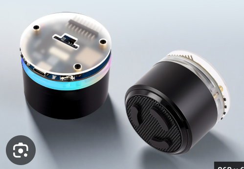

# Target hardware

- Waveshare **ESP32-S3-AUDIO-Board** (cylindrical speaker assembly)
- ESP32-S3 (8 MB PSRAM; flash settings depend on exact board revision)
- ES8311 audio output codec and onboard speaker/amplifier
- ES7210 two-microphone codec for voice capture
- TCA9555 I/O expander for amp/buttons
- Seven WS2812-compatible RGB LEDs
- USB data connection for firmware installation

This firmware is specifically for this Waveshare board, not for a LILYGO T-Embed, Heltec, generic ESP32-S3 DevKit, or Raspberry Pi. Check the original board schematic and GPIO definitions before using a different revision.

Manufacturer documentation: https://docs.waveshare.com/ESP32-S3-AUDIO-Board
