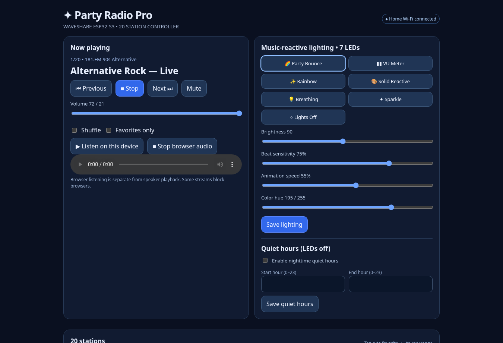

# Web controller

The firmware serves a responsive dashboard directly from `src/web_ui.h`. It can be opened from the speaker setup hotspot at `http://192.168.4.1`, or from the home LAN at `http://waveshare-radio.local` when mDNS resolves.

The dashboard provides radio playback, volume, stations, station management, favorites, shuffle, editable stream URLs, JSON import/export, seven LED modes, animation speed and beat sensitivity, quiet hours, alarm and sleep timer, startup behavior, Wi-Fi and setup-hotspot configuration, voice diagnostics, microphone gain, and service status.

**Screenshot integrity:** screenshots were generated by opening the actual embedded HTML and simulating its JSON API responses with demo values. They are UI screenshots, not captures of actual device state. Do not interpret displayed IP, RAM, connection or voice-recognition status as physical measurements.

**Security:** this is a local, unauthenticated HTTP panel; do not port-forward it to the public Internet. The initial setup hotspot password is `party-radio20`; change it in the controller settings.
